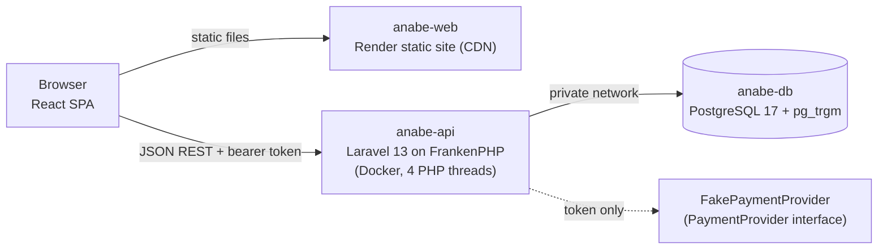
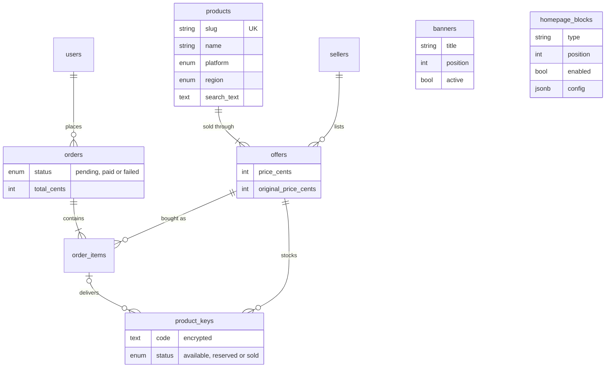

# anabe

A digital game key marketplace in the style of eneba.com, built for the Eneba Intern Assignment 2027.
Demo project, not affiliated with Eneba. No real payments.

**Live:** https://anabe-web.onrender.com (free hosting: the first request after 15 idle minutes takes
30–60 seconds while the server wakes up; the page says so while it waits).

| Try it | |
|---|---|
| Demo account | `demo@example.com` / `anabe-demo` (or register your own) |
| Test card, payment succeeds | `4242 4242 4242 4242`, any future expiry (e.g. `12/30`), any CVC |
| Test card, payment declined | `4000 0000 0000 0002` |
| Search with typos | `wticher`, `skyrm`, `hogwarts legasy`, `battlefeild` |
| Search by abbreviation | `gta`, `rdr2`, `bg3`, `cod`, `tlou` |

## What it does

```
Homepage / Search → Product page → Cart → (log in) → Checkout → Payment → Order + keys
```

Two parts are built in depth; everything else works end-to-end at a solid baseline:

1. **Typo-tolerant search.** Live suggestions while typing (debounced, highlighted, keyboard
   navigation), a results page with filters, and "Did you mean …?" when nothing matches. It handles
   typos, partial names, word order, extra words, accents and abbreviations, using Postgres `pg_trgm`
   with a threshold tuned against a table of real queries ([SearchTest](backend/tests/Feature/SearchTest.php)).
2. **A homepage assembled from independent blocks.** The page asks the backend for its layout, then
   every block (hero banners, bestsellers, deals, new releases, platform rows) loads from its own
   endpoint and provider, with its own skeleton and its own fallback. One failing block does not affect
   the others; this is tested on both sides.

Store (filters, sort, paging, all in the URL), product page with several sellers' offers, accounts,
cart, a transactional checkout with a simulated card payment, and order history with the keys.

Why these two, and every other trade-off: [docs/DECISIONS.md](docs/DECISIONS.md).

## Architecture



Inside the API, controllers stay thin and the logic lives in small classes:

| Concern | Where |
|---|---|
| Search: match, rank, "did you mean" | `app/Search/SearchService.php`, `SearchNormalizer.php` |
| Store query: filters, sort, cheapest offer in stock | `app/Store/ProductListing.php`, `Product::withCheapestOffer()` |
| Homepage blocks | `app/Homepage/BlockRegistry.php`, one provider per type in `app/Homepage/Blocks/` |
| Checkout: reserve → pay → confirm | `app/Checkout/CheckoutService.php` |
| Payment boundary | `app/Payments/` |

In the frontend, every request goes through `src/api/client.ts` and TanStack Query; the homepage's
`BlockRenderer` maps each block type to a component that fetches its own data.

## Data model



- An offer's stock is the number of its `available` keys; there is no stock column to drift.
- Money is integer euro cents everywhere.
- Keys link to order items in one direction only, and a check constraint keeps
  "available ⇔ not linked to an order" true.
- Key codes are encrypted at rest with `APP_KEY`.

## Tech stack

- **Frontend:** React 19, TypeScript (strict), Vite, TanStack Query, React Router, Tailwind CSS v4, Vitest
- **Backend:** PHP 8.5, Laravel 13, Laravel Sanctum, PHPUnit; FrankenPHP in production
- **Database:** PostgreSQL 17 with `pg_trgm`
- **Hosting:** Render (static site, Docker web service, Postgres), all defined in [render.yaml](render.yaml)

## Repository layout

```
backend/    Laravel API (backend/docker/: production start script and FrankenPHP config)
frontend/   React app
docs/       DECISIONS.md: decisions, alternatives and reasons
scripts/    export-chat-logs.mjs: turns the AI chat transcripts into ai-logs/*.md
ai-logs/    Full AI agent chat history (assignment deliverable)
PLAN.md     Project plan
render.yaml Production infrastructure
```

## Running locally

Requirements: PHP 8.5 with `pdo_pgsql`, Composer, Node 24, Docker.

```sh
# 1. Database (Postgres 17 on localhost:5432, plus a separate anabe_test database for tests)
docker compose up -d --wait

# 2. Backend on http://localhost:8000
cd backend
composer install
cp .env.example .env
php artisan key:generate
php artisan migrate --seed      # ~85 products, sellers, offers, keys, orders, banners, homepage
php artisan serve

# 3. Frontend on http://localhost:5173 (in a second terminal)
cd frontend
npm install
cp .env.example .env
npm run dev
```

The placeholder covers in `backend/public/covers/` are generated and committed; after changing the
catalog in `backend/database/seeders/data/`, regenerate them with `php artisan catalog:generate-art`.

## Tests

```sh
cd backend && php artisan test        # PHPUnit against the anabe_test Postgres database (all suites)
cd frontend && npm test               # Vitest + React Testing Library
cd frontend && npm run typecheck      # strict TypeScript
```

On Windows, run the frontend tests from a path with an upper-case drive letter (`C:\…`); with `c:\…`
Vitest loads its setup file twice and every test file fails to start.

## Deployment

Production runs on Render's free plan in Frankfurt. All of it is defined in [render.yaml](render.yaml):

| Resource    | Type                 | What it is |
|-------------|----------------------|------------|
| `anabe-web` | Static site          | The React app, built from `frontend/` and served from Render's CDN |
| `anabe-api` | Docker web service   | The Laravel API, built from `backend/Dockerfile` and served by FrankenPHP. On start it caches config, runs migrations, seeds an empty database, makes sure the demo account exists, starts the scheduler, then serves requests |
| `anabe-db`  | Render Postgres 17   | Reachable only from Render's private network |

Every push to `main` that passes CI redeploys whichever of the two apps changed.

The free Render Postgres database was created on 2026-11-16 and **expires on 2026-12-16**. To replace it,
recreate the database from the Blueprint and redeploy the API, which migrates and seeds the new
database on start.

**First-time setup** (once, in the Render dashboard): in the `anabe` workspace choose
New → Blueprint, pick this repository and apply. Render asks for the one secret, `APP_KEY`.
Generate it locally with `php artisan key:generate --show`, copy it into the dashboard, and do not
keep it anywhere else.

## AI chat logs

The full conversation with the AI agent is in [ai-logs/](ai-logs/), exported from the Claude Code
transcripts with:

```sh
EXPORT_SCRUB_NAMES="First Last,Last" node scripts/export-chat-logs.mjs
```

Prompts and replies are complete; tool calls and results are shortened; email addresses, names, local
paths, account ids and anything shaped like a key or token are replaced with placeholders.

## Admin

`/admin` (linked in the header for admins) manages the homepage layout (add a block such as a new
platform row, rename, hide, reorder, delete), switches hero banners on and off, and adds key codes to a
seller's offer. Changes show on the homepage immediately.

Admins are the emails in `ADMIN_EMAILS`. Locally that is `admin@example.com` / `anabe-admin` (created
by the seeder); production's list is set in the Render dashboard, so there is no public admin login.

## Checkout safety

- **Concurrent buyers:** keys are taken with `FOR UPDATE SKIP LOCKED`.
  [CheckoutConcurrencyTest](backend/tests/Feature/CheckoutConcurrencyTest.php) holds a key locked from
  a second database connection and proves checkout neither waits nor sells it twice.
- **Abandoned checkouts:** if the server stops between reserving keys and confirming payment, a
  scheduled job (`checkout:release-expired`, every minute) puts keys of orders pending for more than
  15 minutes back on sale.

## CI

[.github/workflows/ci.yml](.github/workflows/ci.yml) runs Pint and PHPUnit against Postgres 17, and the
frontend's typecheck, lint, tests and build, on every push and pull request. Render deploys a commit
only once these checks pass.

## What I would do next

- **Payment provider:** replace the fake provider with Stripe payment intents and webhooks, and refund
  automatically when a payment completes after its reservation expired (today it is only logged).
- **Seller self-service:** let sellers manage their own offers and upload keys, with roles instead of
  an admin email list.
- **Search at scale:** a dedicated engine (Meilisearch/Elasticsearch) with per-word edit distance,
  synonyms and popularity ranking, once the catalog or traffic outgrows Postgres trigrams
  ([DECISIONS.md #21](docs/DECISIONS.md)).
